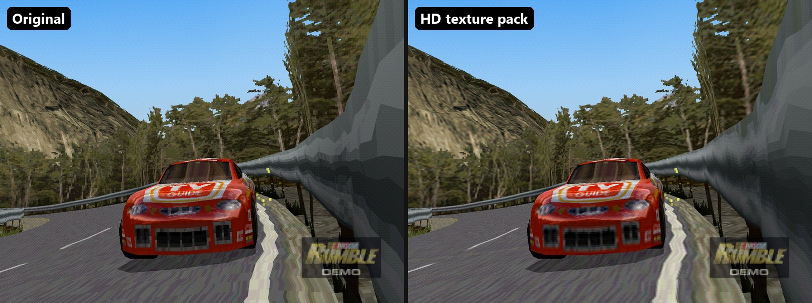
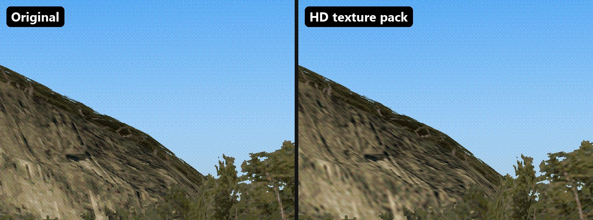
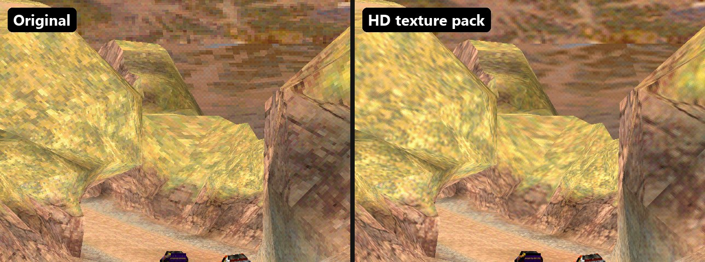

# NASCAR Rumble PC: play the PS1 game natively on Windows with HD textures and 60 fps

**Play NASCAR Rumble (PlayStation, 2000) on PC.** This is not an emulator: the game is statically recompiled into a native Windows `.exe` with [psxrecomp](https://github.com/RetroPortingToolKit/psxrecomp). The repo gives you free tools, patches and step-by-step guides to build it from your own disc, with high-resolution rendering, an HD texture pack and smooth 60 fps races.

📖 **Website and guide:** https://kelvinc54.github.io/nascar-rumble-pc/



| Original PS1 textures vs HD texture pack | |
|---|---|
|  |  |

## Features

On top of the base port, it adds:

- **High resolution rendering.** 3D renders at your monitor's resolution or higher, with optional supersampling and perspective-correct texturing.
- **An HD texture pack pipeline.** It pulls the original textures off *your* disc, captures how the game recolours them at runtime, upscales them (Real-ESRGAN plus Lanczos, with a quality gate), and writes a DuckStation-format pack.
- **Race performance fixes.** These include two runtime patches, a no-PGXP build and a PGO build. On a laptop with an integrated GPU, races went from about 10–16 fps to about 50–60 fps.
- **A demo-track picker mod.** It makes the attract demo race a chosen track, so every track can be captured unattended.

> ## ⚠️ Disclaimer: fan made, not a game distribution
>
> This is an unofficial, non-commercial **fan project**, made as a hobby to help people who own the game play it on a PC. It is not affiliated with or endorsed by Electronic Arts, NASCAR or Sony.
>
> **This repository does not contain the game.** It contains no disc image, executable, game code (original or recompiled), textures, audio, video or texture pack. Everything game-related is produced locally on your own machine from **your own legally obtained copy** of the disc. Please do not open issues asking for game files, and do not upload builds or texture packs made from the game.
>
> ---
>
> **Indonesia:** Ini proyek **buatan fan (fan made)**. Tidak resmi, tidak komersial, dan tidak berafiliasi dengan EA, NASCAR, maupun Sony. Proyek ini **tidak bermaksud mendistribusikan game berlisensi**. Repo ini tidak berisi file game apa pun: tidak ada ISO/BIN, exe, kode game, tekstur, maupun texture pack. Semuanya dibuat sendiri di PC kamu dari **disc/backup milikmu sendiri**. Dibuat hanya untuk hobi dan untuk membantu orang lain yang ingin memainkan game ini di PC.

## What you need

- **Your own NASCAR Rumble (USA) disc or backup** as a `.cue` + `.bin` file.
- **Windows 10 or 11 (x64)** and a GPU with OpenGL 3.3.
- **[Git for Windows](https://git-scm.com/download/win)**, which provides the Git Bash shell.
- **Python 3.10 or newer**, then run `pip install pillow numpy`.
- **About 15 GB of free disk space** for the toolchain, the generated code and the builds.
- **Optional, for the HD textures:** a Vulkan GPU for Real-ESRGAN. Without one, the pipeline falls back to Lanczos.

## Guides

| Step | Guide | Result |
|---|---|---|
| 1 | [Build the native game](docs/1-build.md) | `NascarRumble_Recompiled.exe` running from your disc |
| 2 | [HD texture pack](docs/2-hd-textures.md) | Sharper track, sky and car textures, built from your disc |
| 3 | [Performance notes](docs/3-performance.md) | Why races lagged, what fixed it, and how to profile |
| – | [Tool reference](docs/tools.md) | What each script in `tools/` does |

## Repository layout

```
tools/        Python / shell / C helper tools (no binaries)
patches/      psxrecomp runtime patch + project CMake/game.toml patch
mods-src/     nascar.demo-track mod (declarative psxrecomp mod package)
launchers/    Play NASCAR Rumble.bat (fast) and (PGXP).bat
docs/         step-by-step guides
```

The guides assume this repository **is your workspace folder**. The toolchain, the psxrecomp checkout, the game project and the work folders are all created inside it and git-ignored. For example:

```
C:\NascarPC\            <- git clone of this repo
  toolchain\            <- portable clang/cmake/ninja (step 1)
  nascar-rumble-recomp\ <- generated game project + builds (step 1)
  disc-extract\  raw-blocks\  pack-work\   <- texture work (step 2)
```

## FAQ

**How do I play NASCAR Rumble on PC?**
1. Dump your own NASCAR Rumble (USA) disc to `.bin`/`.cue`.
2. Follow [guide 1](docs/1-build.md) to recompile it into a native Windows executable with psxrecomp.
3. Start it with `Play NASCAR Rumble.bat`.

No emulator or BIOS file is needed to play.

**Is this an emulator like DuckStation or ePSXe?**
No. The game's MIPS code is translated to C and compiled for x64, which makes it a native PC port. The runtime still handles PS1 graphics and sound, but there is no CPU emulation loop.

**Does it have HD textures or a texture pack for NASCAR Rumble?**
Yes, but you build it yourself from your disc with [guide 2](docs/2-hd-textures.md). It uses AI upscaling (Real-ESRGAN) for detailed surfaces like rock and cliffs and Lanczos for the rest. The HUD and menus stay native, because they look sharper that way.

**Can I download the game or a ready-made exe here?**
No, and please don't ask. This repo contains no game files. You need your own copy.

**Does NASCAR Rumble run at 60 fps on PC?**
Yes. The fast build (PGO, no PGXP) and the runtime patches took races on a low-end iGPU laptop from 10–16 fps to about 60 fps. See [performance notes](docs/3-performance.md).

**Which version of the game is supported?**
NASCAR Rumble USA, SLUS-01068. The wizard checks the disc's hashes.

**Does it support widescreen, controllers or fullscreen?**
- **Fullscreen:** F11 or Alt+Enter.
- **Controllers:** configure them in the psxrecomp launcher. Two players are supported.
- **Resolution:** the internal resolution can be the monitor's resolution, 4x, 8x or 4K.
- **Widescreen:** the build is 4:3.

## Credits

- [psxrecomp / RetroPortingToolKit](https://github.com/RetroPortingToolKit/psxrecomp) provides the recompiler, runtime, launcher and mod system. Its own license (PolyForm Noncommercial 1.0.0) applies to it and to the patches in `patches/`, which modify it.
- [Real-ESRGAN](https://github.com/xinntao/Real-ESRGAN) by Xintao Wang et al. is used for the AI upscaling.
- The texture pack naming is the format DuckStation uses for texture replacements.

## License

The original tools, docs and mod in this repository are released under the [MIT License](LICENSE). The files in `patches/` are modifications of psxrecomp and stay under psxrecomp's PolyForm Noncommercial license. *NASCAR Rumble* and all of its content belong to their respective owners.
