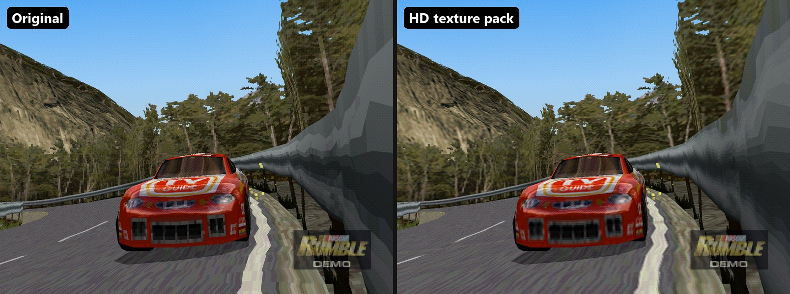
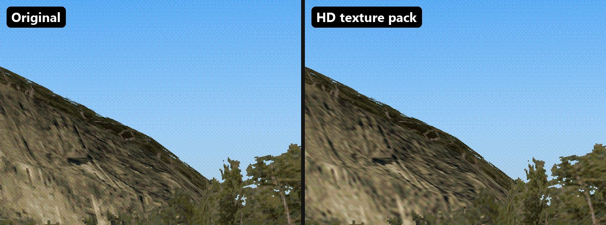
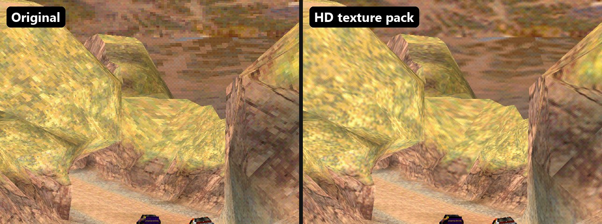

# Play NASCAR Rumble on PC

**NASCAR Rumble** (PlayStation, 2000) can run on Windows as a **native PC port**, not an emulator. This free, fan-made toolkit recompiles the game from **your own disc** with [psxrecomp](https://github.com/RetroPortingToolKit/psxrecomp). It adds:

- high-resolution rendering, up to 4K or 8x
- an **HD texture pack** you build yourself (AI upscaling with Real-ESRGAN)
- smooth **60 fps races**, even on a laptop with integrated graphics

[Get the tools on GitHub](https://github.com/KelvinC54/nascar-rumble-pc)

## Guides

1. [Build NASCAR Rumble for PC](1-build.md): toolchain, recompiling from your disc, and the fast and PGXP builds
2. [NASCAR Rumble HD texture pack](2-hd-textures.md): extracting, capturing, AI upscaling and building the pack
3. [Performance: fixing race lag](3-performance.md): getting from 10 fps to 60 fps on a low-end PC
4. [Tool reference](tools.md)

## FAQ

### How do I play NASCAR Rumble on PC?
1. Dump your own NASCAR Rumble (USA, SLUS-01068) disc to `.bin`/`.cue`.
2. Follow the [build guide](1-build.md) to turn it into a native Windows executable.
3. Start it with `Play NASCAR Rumble.bat`.

### Is this an emulator?
No. The game's MIPS code is translated to C and compiled for x64, which makes it a native port. No emulator or BIOS file is needed to play.

### Is there an HD texture pack for NASCAR Rumble?
Yes, but you build it from your own disc with the [HD texture guide](2-hd-textures.md). Detailed surfaces such as rock and cliffs are upscaled with AI. The HUD and menus stay native, because they look sharper that way.

### Does NASCAR Rumble run at 60 fps on PC?
Yes. With the fast build and the runtime patches, races went from 10–16 fps to about 60 fps on a laptop iGPU.

### Can I download the game here?
No. **No game files are included or distributed**: no ISO, exe, code, textures or texture pack. You need your own legally obtained copy.

## Disclaimer

This is an unofficial, non-commercial **fan-made** project, made as a hobby to help people play a game they own on PC. It does not intend to distribute licensed games. It is not affiliated with or endorsed by Electronic Arts, NASCAR or Sony. *NASCAR Rumble* and its content belong to their respective owners.

*Indonesia: proyek buatan fan, tidak resmi, tidak komersial, dan tidak bermaksud mendistribusikan game berlisensi. Dibuat hanya untuk hobi dan untuk membantu orang lain yang ingin memainkan game ini di PC dengan disc miliknya sendiri.*
